# Informe complementario: el índice de manipulación lingüística y los estilos discursivos

*Natali Alba Tobías y Daniel Santiago Camacho Gutiérrez*

En la tesis, el índice de manipulación lingüística (IML) y los estilos discursivos ocupan las Subsecciones 3.4.3 y 3.4.4 (construcción) y 4.2.3 y 4.2.4 (resultados). Este informe explica con más detalle cómo los construimos, qué decisiones tomamos antes de mirar los resultados y cuáles después, qué muestran los datos más allá de lo que cupo en el documento y cómo se reproduce cada cifra. Todo el cálculo está en `Explicabilidad_Propia/codigos/estilos_discursivos.py`.


---

## 1. Por qué un índice y unos estilos

Las 43 variables describen una noticia con mucho detalle, pero una persona no puede leer 43 números a la vez. Quisimos dos lecturas más cortas, ambas **descriptivas**:

- **El IML** responde a «¿cuánto se apoya este texto en los recursos de estilo que la literatura asocia con la manipulación?». Es un número de 0 a 100.
- **Los estilos discursivos** responden a «¿a qué tipo de escritura se parece este texto?». Es un perfil que combina los rasgos.

Ninguno de los dos usa la etiqueta de veracidad en su construcción. La etiqueta solo aparece después, para describir cómo se reparten las noticias falsas. Así el índice no es un clasificador encubierto y su relación con la veracidad se puede evaluar honestamente.

## 2. De 43 variables a cinco dimensiones

### 2.1 Qué variables entran y con qué dirección

Entran 28 de las 43 variables: las que tienen en la literatura una **dirección fijada de antemano**. Con ↑, más valor indica un estilo más marcado; con ↓, lo contrario. Las agrupamos en cinco dimensiones:

| Dimensión | Rasgo que resume | Variables |
|:---|:---|:---|
| **D1 Sensacionalismo** | Tono llamativo o exagerado | Probabilidad de sensacionalismo del documento, media y máximo por oración (↑) |
| **D2 Carga emocional** | Emociones de alta activación | Intensidad emocional, ira, miedo y sorpresa, media y máximo (↑) |
| **D3 Reiteración** | Repetir la misma idea | Similitud máxima, media, de los tres pares más parecidos y entre oraciones consecutivas (↑) |
| **D4 Énfasis ortotipográfico** | Énfasis visual | Mayúsculas sostenidas, proporción de mayúsculas, exclamaciones, interrogaciones, puntos suspensivos y comillas (↑) |
| **D5 Aserción sin respaldo** | Certeza sin anclajes verificables | Intensificadores, primera persona y adjetivación (↑); atenuadores, verbos de atribución, cifras y referencias temporales (↓) |

D5 es la más elaborada. Recoge la idea de que el periodismo informativo se ancla en atribuciones («dijo», «declaró»), cifras y fechas, mientras que el texto que afirma sin respaldo usa intensificadores, primera persona y adjetivación (Zhou y Zafarani, 2020).

Las 15 variables restantes quedan fuera por un motivo explícito, fijado en `EXCLUIDAS`:

- **Sin dirección:** las dispersiones, `sens_sd_oraciones` y `red_sim_varianza`.
- **Ambigua:** `red_consecutivas_min`, porque una oración inconexa puede ser tanto manipulación como estilo informativo.
- **Baja activación o valencia positiva:** tristeza y alegría.
- **Miden complejidad, no manipulación:** Flesch-Szigriszt, Guiraud y hapax.
- **Sin dirección establecida en español:** adverbios y pronombres de tercera persona.
- **Redundante:** porcentajes, que repite a cifras.
- **Longitud:** palabras y oraciones.

El script comprueba con un `assert` que las variables usadas y las excluidas suman exactamente las 43. Si alguien añade una variable a la tabla sin clasificarla, el programa se detiene.

### 2.2 Cálculo en tres pasos

**Paso 1. Percentil orientado de cada variable** (Ec. 3.5; `percentil()`). Cada valor se convierte en su percentil dentro de los 4.100 textos únicos del corpus. Los empates reciben el rango medio. Si la dirección es ↓, se usa 100 − percentil. Así todas las variables quedan en la misma escala y con el mismo sentido.

**Paso 2. Puntaje de la dimensión** (Ec. 3.6; `dimensiones_brutas()` y `dimensiones_de()`). Se promedian los percentiles de las variables de la dimensión, y **ese promedio se vuelve a convertir en percentil** dentro del corpus. El segundo paso corrige un efecto de los promedios: cuando una dimensión junta muchas variables poco correlacionadas, como D4 (seis signos distintos) o D5 (siete marcadores), su media se concentra cerca de 50 y la dimensión parecería siempre «normal». Al recalcular el percentil, las cinco dimensiones recorren de 0 a 100 de la misma manera y son comparables.

**Paso 3. IML** (Ec. 3.7). Es la media simple de las cinco dimensiones, sin pesos ni constantes ajustadas. En los textos de una sola oración no existe la reiteración: falta D3 y se promedian las otras cuatro.

Un IML de 70 se lee como «este texto usa esos recursos más que el 70 % de las noticias del corpus». Es una posición relativa, no una medida absoluta de manipulación.

### 2.3 ¿Miden cosas distintas las cinco dimensiones?

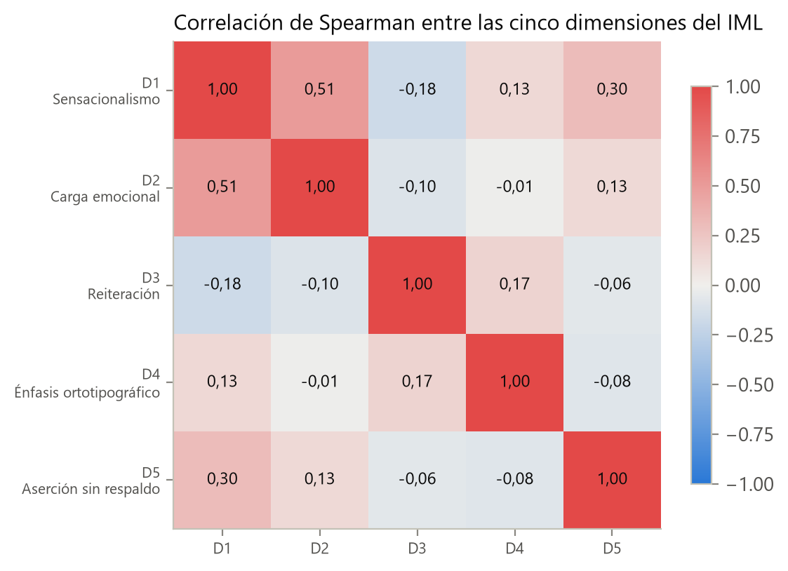

*Figura nueva de este informe (`Informes_complementarios/figuras_informes.py`, desde `metricas_iml_estilos_discursivos.json`).*

- La correlación más alta es D1–D2 (ρ = 0,51): el sensacionalismo suele ir con emoción, pero no siempre. Es lo esperable, porque JJNeila y RoBERTuito leen rasgos cercanos del texto.
- El resto de correlaciones es baja (|ρ| ≤ 0,30).
- La reiteración (D3) se correlaciona levemente en negativo con D1 y D2. Los textos que repiten ideas tienden a ser más planos.

Mantener las cinco dimensiones separadas está justificado: ninguna es redundante con otra.

## 3. El IML frente a la veracidad (Tabla 4.6)

| Indicador | AUC (clase falsa) | Media en falsas | Media en reales |
|:---|---:|---:|---:|
| D1 Sensacionalismo | 0,612 | 56,2 | 45,0 |
| D2 Carga emocional | 0,565 | 53,6 | 47,1 |
| D3 Reiteración | 0,454 | 47,5 | 52,0 |
| D4 Énfasis ortotipográfico | 0,520 | 51,1 | 49,1 |
| D5 Aserción sin respaldo | 0,598 | 55,4 | 45,6 |
| **IML** | **0,593** | 52,8 | 47,8 |

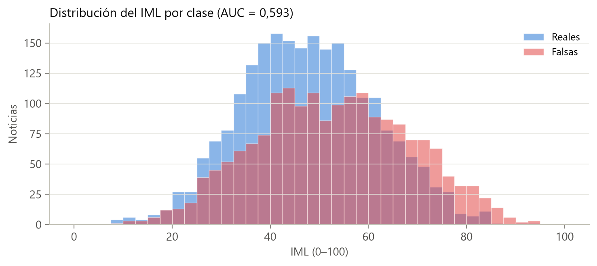

Las noticias falsas tienen en promedio un IML más alto, pero las distribuciones se solapan casi por completo (AUC 0,593). Hay dos lecturas que conviene separar:

1. **El índice no sirve para decidir** si una noticia es falsa. Nunca lo propusimos para eso.
2. **Algunas direcciones fijadas *a priori* no se cumplen en este corpus.** En 20 de las 28 variables la dirección observada coincide con la esperada. Las 8 restantes (las 4 de redundancia, proporción de mayúsculas, comillas, adjetivación y atenuadores) tienen AUC entre 0,45 y 0,52. No las retiramos ni invertimos su sentido: eso sería ajustar el índice a la etiqueta, y el IML dejaría de describir el constructo de la literatura. Las direcciones observadas se guardan en `metricas_iml_estilos_discursivos.json` → `direccion_empirica`.

La reiteración es el caso más claro de dirección contraria: las noticias reales reiteran algo más que las falsas (Subsección 4.2.2).

## 4. Los estilos discursivos

### 4.1 Espacio y algoritmo

Aplicamos k-medias (`n_init = 20`, y 50 en el ajuste final) sobre las cinco dimensiones (D1, …, D5) de los 4.100 textos únicos. Cuando falta D3 usamos el valor neutro de 50. No hace falta estandarizar, porque las dimensiones ya están en la misma escala de 0 a 100.

### 4.2 Cuántos estilos: una regla fijada antes de mirar

La regla quedó escrita en el código (`K_MIN, K_MAX = 3, 6`) antes de ver los resultados:

1. **Rango de k entre 3 y 6.** Con k = 2 los grupos solo separan «más» de «menos» a lo largo de un eje (casi el IML partido en dos) y no describen combinaciones de rasgos. Por encima de 6, una persona ya no puede retener los estilos. Los valores 2, 7 y 8 se calculan como referencia.
2. **Estabilidad mínima.** Para cada k hicimos 30 remuestreos *bootstrap*, reajustamos k-medias y medimos el ARI entre la partición original y la remuestreada. Exigimos un ARI medio de al menos 0,75: un estilo que cambia al remuestrear no se puede ofrecer como descripción.
3. **Entre los k estables, el de mayor silueta.**

| k | Silueta | ARI medio | ARI, percentil 5 |
|---:|---:|---:|---:|
| 2 | 0,220 | 0,953 | 0,917 |
| **3** | **0,193** | **0,756** | **0,413** |
| 4 | 0,184 | 0,649 | 0,399 |
| 5 | 0,184 | 0,723 | 0,542 |
| 6 | 0,188 | 0,764 | 0,545 |
| 7 | 0,183 | 0,678 | 0,486 |
| 8 | 0,182 | 0,559 | 0,423 |

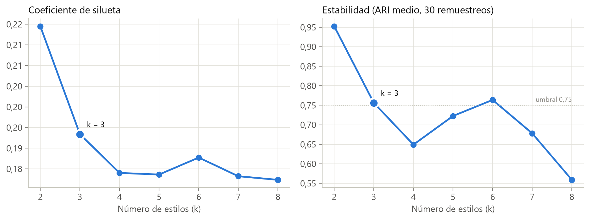

Son estables k = 3 (0,756) y k = 6 (0,764). Gana k = 3 por silueta (0,193 frente a 0,188).

Lo decimos sin rodeos: la estabilidad es **marginal**. El ARI medio apenas supera 0,75, y en el 5 % de los remuestreos menos favorables cae a 0,413. Además, las siluetas de 0,18 a 0,22 indican que en este espacio no hay grupos naturales bien separados. Los estilos son **zonas de un continuo**, no tipos discretos. Por eso informamos siempre la pertenencia a cada estilo y no solo el dominante (sección 4.4).

### 4.3 Cómo se nombran

Un estilo no debe recibir su nombre por el número del grupo, que depende de la semilla, ni por la proporción de falsas, que haría circular la descripción. La función `asignar_nombres()` aplica una regla explícita sobre los centros:

- **Alarmista / Viral:** el centro con la mayor media de D1, D2 y D4.
- De los otros dos, **Institucional / Técnico** es el de menor D1 + D2, y además debe tener menor D5.
- **Opinión / Crónica** es el restante, y debe tener menor D3.

Si un centro no cumple su condición, el script se detiene con un error en lugar de forzar un nombre. Además, `nombrar()` genera una descripción automática de cada centro a partir de los rasgos claramente altos (≥ 60) o bajos (≤ 40). Esa descripción queda guardada junto al nombre como su justificación.

| Estilo | D1 | D2 | D3 | D4 | D5 | IML del centro | Descripción automática | Lema |
|:---|---:|---:|---:|---:|---:|---:|:---|:---|
| Institucional / Técnico | 25 | 29 | 63 | 54 | 36 | 41,3 | Reiterativo, sin sensacionalismo, carga emocional ni aserción sin fuentes | Tono formal y factual, con ideas clave reiteradas y fuentes citadas |
| Opinión / Crónica | 57 | 57 | 28 | 26 | 60 | 45,7 | Moderado, sin reiteración ni énfasis ortotipográfico | Relato o comentario fluido, subjetivo pero con escritura estándar |
| Alarmista / Viral | 76 | 70 | 57 | 71 | 59 | 66,6 | Sensacionalista, emotivo y enfático | Alto dramatismo, tono emocional y énfasis visual (mayúsculas y signos) |

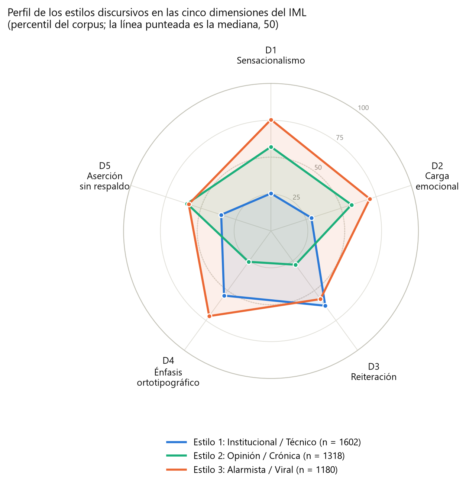

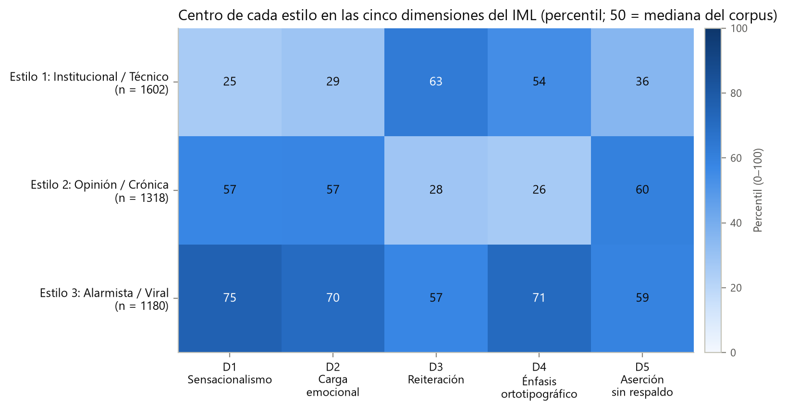

Los nombres interpretan el **perfil lingüístico** del centro. No afirman que las noticias pertenezcan al género periodístico homónimo, porque el género real no está anotado en el corpus.

### 4.4 Pertenencia difusa

La pertenencia de una noticia a cada estilo es el inverso de su distancia euclídea a cada centro, normalizado para que sume 100 % (Ec. 3.9; `pertenencias()`). La pertenencia media al estilo dominante es:

| Estilo | Pertenencia media al dominante |
|:---|---:|
| Institucional / Técnico | 45,9 % |
| Opinión / Crónica | 44,1 % |
| Alarmista / Viral | 45,3 % |

Con tres estilos, el reparto uniforme sería 33,3 %. Una pertenencia media del 45 % confirma lo que decía la silueta: una noticia típica se parece algo más a un estilo que a los otros, pero no pertenece a uno solo. Por eso el auditor informa el estilo dominante, el secundario y el vector completo.

### 4.5 Tamaño de cada estilo y noticias falsas (Tabla 4.8)

| Estilo | Noticias | % del corpus | % falsas |
|:---|---:|---:|---:|
| Institucional / Técnico | 1.602 | 39,1 % | 34,6 % |
| Opinión / Crónica | 1.318 | 32,1 % | 46,2 % |
| Alarmista / Viral | 1.180 | 28,8 % | 56,9 % |

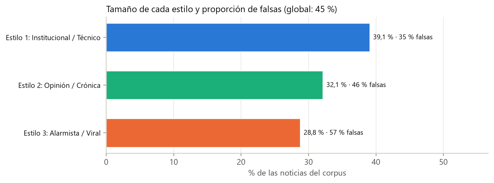

En el corpus hay un 44,8 % de falsas. La proporción crece de un estilo a otro, pero el estilo más «alarmista» sigue teniendo un 43 % de noticias reales. El estilo orienta, no decide.

### 4.6 Análisis adicional: estilos por región

Este análisis no está en la tesis. Lo añadimos porque ayuda a leer la tabla anterior con cautela.

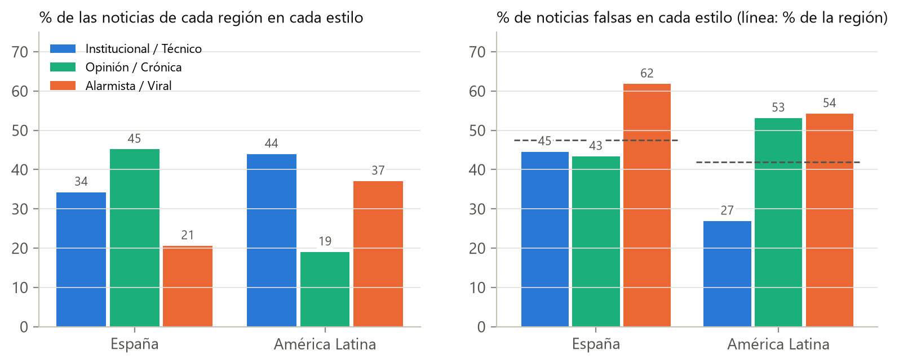

*Figura nueva de este informe, generada desde `Explicabilidad_Propia/reportes/iml_estilos_discursivos_4418.csv` (textos únicos).*

| Región | Textos únicos | Institucional / Técnico | Opinión / Crónica | Alarmista / Viral | % falsas en la región |
|:---|---:|---:|---:|---:|---:|
| España | 2.059 | 705 (34 %) | 930 (45 %) | 424 (21 %) | 47,5 % |
| América Latina | 2.041 | 897 (44 %) | 388 (19 %) | 756 (37 %) | 42,0 % |

Se observan dos cosas:

1. **La composición de estilos depende mucho de la región.**
   - En España domina Opinión / Crónica (45 %).
   - En América Latina dominan Institucional / Técnico (44 %) y Alarmista / Viral (37 %).
   - Esto refleja en buena parte las fuentes que componen cada región. Las noticias latinoamericanas proceden sobre todo de Omdena, MEX-A3T y FakeDeS, con estilos de redacción muy distintos entre sí.
2. **La relación entre estilo y falsedad cambia con la región.**
   - En España, Alarmista / Viral concentra un 62 % de falsas, y los otros dos estilos están cerca de la media regional (45 % y 43 %).
   - En América Latina el contraste está en otro sitio: Institucional / Técnico tiene un 27 % de falsas, frente a un 53–54 % en los otros dos.

   Así, la frase «a más alarmismo, más falsas» resume bien a España, pero en América Latina lo que distingue es lo institucional frente a todo lo demás.

Es el mismo fenómeno que la tesis documenta para los clasificadores (Sección 4.4): las señales de estilo dependen del dominio y de la fuente. Por eso los estilos se presentan como descripción del texto y no como evidencia de veracidad.

### 4.7 Cómo se ven en dos dimensiones

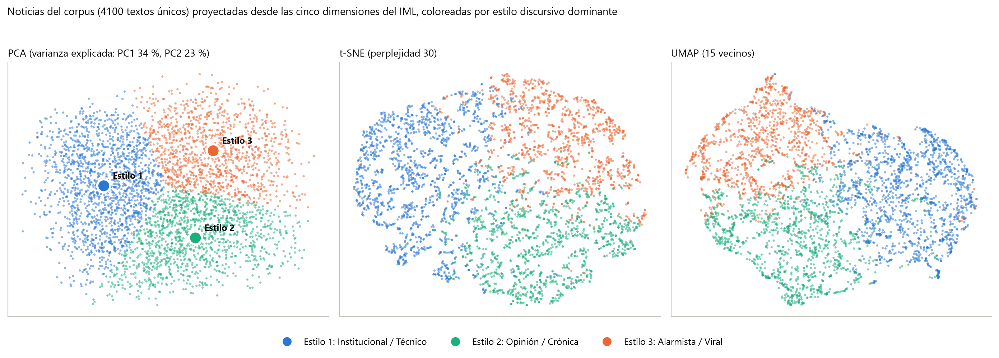

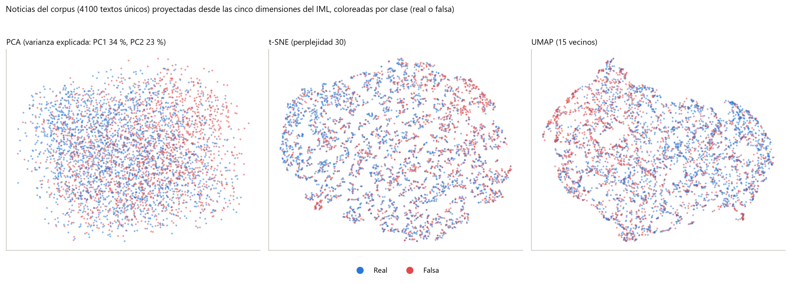

- **PCA.** Los dos primeros componentes explican el 34 % y el 23 % de la varianza. El primero carga sobre D1 (0,65), D2 (0,58) y D5 (0,40): es un eje de **intensidad del contenido**. El segundo carga sobre D4 (0,79) y D3 (0,55): es un eje de **forma**, con énfasis visual y repetición. Los tres estilos se ordenan a lo largo de esos dos ejes.
- **t-SNE (perplejidad 30) y UMAP (15 vecinos).** Conservan vecindades, no distancias globales. Por eso la vecindad se mide en el espacio original de cinco dimensiones:
  - Entre los 15 vecinos más cercanos de cada noticia, el 89 % comparte su estilo, frente a un 34 % al azar. En buena medida es esperable por construcción.
  - Solo el 54 % comparte su clase, frente a un 51 % al azar.

  La geometría del estilo casi no separa la veracidad.

## 5. Perfilar un texto nuevo

`estilos_discursivos.py` guarda en `codigos/referencia_iml_estilos.json`:

- la distribución ordenada de cada variable y de cada dimensión bruta de los 4.100 textos;
- los centros de los estilos y sus nombres, lemas y descripciones.

Con eso, `perfilar(variables)` sitúa cualquier texto nuevo frente al corpus sin volver a leer la tabla: calcula los percentiles, las dimensiones, el IML, el estilo dominante, el secundario y la pertenencia. El auditor lo usa así:

```bash
python Explicabilidad_Propia/auditar_texto_personalizado.py --texto "Titular. Cuerpo de la noticia..."
```

Además, la explicación por oraciones aplicada al IML indica qué oración sube o baja cada dimensión. En el caso 1 de la tesis, el titular en mayúsculas aporta +27,2 puntos al IML.

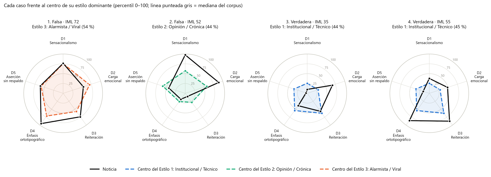

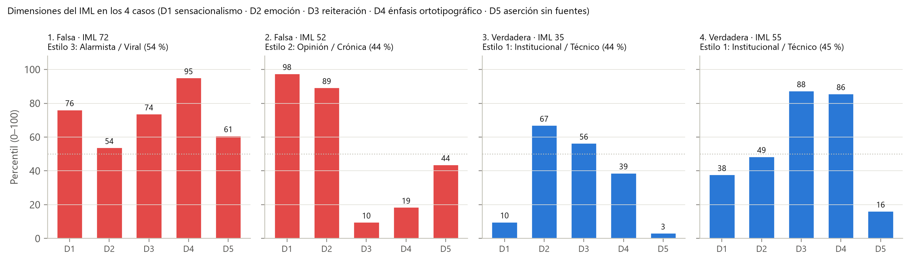

## 6. Cadena de reproducción

| Elemento de la tesis | Script | Datos |
|:---|:---|:---|
| Tabla 4.6, Figura de distribución del IML | `Explicabilidad_Propia/codigos/estilos_discursivos.py` | `Modelo_sobre_Variables/Dataset/tabla_variables_4418.csv` |
| Tablas 4.7–4.8, Figuras 4.10–4.13 | mismo script | mismo CSV → `reportes/metricas_iml_estilos_discursivos.json` y `graficos/estilos/` |
| IML, estilo y pertenencias por noticia | mismo script | → `reportes/iml_estilos_discursivos_4418.csv` |
| Referencia para textos nuevos | mismo script | → `codigos/referencia_iml_estilos.json` |
| Casos de estudio (Tabla 4.20, Figs. 4.25–4.26) | `Analisis_complementarios/ejecutar_casos_originales.py` | auditor + referencia |
| Figuras nuevas de este informe | `Informes_complementarios/figuras_informes.py` | CSV y JSON anteriores |

Todo se reproduce sin GPU y sin conexión a internet, en pocos minutos, a partir de la tabla de variables incluida. La semilla es 42 en k-medias, en los remuestreos y en las proyecciones.

## 7. Limitaciones

1. El IML es un índice compuesto **descriptivo y exploratorio**. No mide la intención de manipular, no está validado como medida de ese constructo y no tiene interpretación causal.
2. Los percentiles son relativos a este corpus (España y América Latina, 70 a 370 palabras). Un mismo texto tendría otro IML frente a otro corpus de referencia.
3. Ocho de las 28 direcciones fijadas *a priori* no se cumplen aquí. Las conservamos para no ajustar el constructo a la etiqueta.
4. Los estilos tienen silueta baja y estabilidad marginal. Son zonas de un continuo, y sus nombres interpretan el perfil, no el género periodístico.
5. La composición de estilos y su relación con la falsedad cambian entre regiones, como muestra la sección 4.6. No deben leerse como un patrón universal.
6. D1 y D2 heredan las limitaciones de sus instrumentos (JJNeila y RoBERTuito), que no alcanzaron el criterio de aceptación (Subsección 4.2.1).
